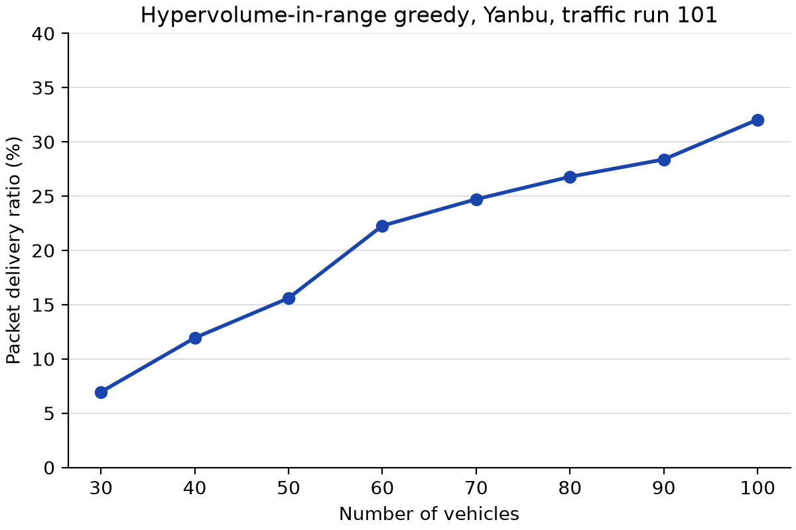

# LOGIC forwarding: a minimal demonstration

This is a proof of concept for LOGIC, a local geographic forwarding scheme for VANETs.
It runs one objective, hypervolume-in-range greedy (f5).
It reports one metric, the packet delivery ratio (PDR).
The input is one SUMO traffic run from Yanbu Industrial City, Saudi Arabia.



## Run

Use Python 3.10 or later.

```sh
python -m pip install -r requirements.txt
python demo.py
```

The script prints the PDR at each vehicle count.
It saves the figure as `demo_results.png`.
It takes a few seconds.
No SUMO installation is needed.

## Expected output

```
Vehicles   PDR (%)
      30      6.95
      40     11.94
      50     15.60
      60     22.27
      70     24.72
      80     26.79
      90     28.38
     100     32.05
```

These values are traffic run 101 of the paper's evaluation.
The demo gives the same path and the same delivered packets as the paper's evaluator for all 1,216 attempts.
The paper reports the mean of five runs, seeds 101 to 105.
That mean is 32.90% at 100 vehicles.
A single run therefore differs from the paper's curve.

## What the script does

For each case, the source builds a path one hop at a time.
The current sender considers its neighbours within 50 m.
A candidate must be closer to the destination and must not be visited before.
If the destination is in range, the packet goes to it directly.

Each candidate is predicted over H = 3 s at Δt = 1 s, so at four instants.
Vehicles keep their speed and heading.
Two values are averaged over these instants:

- progress: the relative reduction in distance to the destination
- availability: the share of instants at which the link stays within range

Both values are min–max normalized over the candidates.
The score is (availability + 0.5) × (progress + 0.5).
The candidate with the highest score becomes the next sender.
A route fails if no candidate remains or it exceeds 20 links.

Seven packets are then sent along the fixed path at 0, 3, …, 18 s.
Each hop takes its airtime and succeeds only if the link is in range when it starts.
A packet counts as delivered if it arrives within its 15 s TTL.
Failed routes stay in the denominator.
PDR is 100 × delivered packets / offered packets at each vehicle count.

## Settings

| Setting | Value |
|---|---|
| Communication range | 50 m |
| Maximum forwarding links | 20 |
| Prediction horizon and sampling interval | H = 3 s, Δt = 1 s |
| Packet payload | 1024 bytes |
| Packet send times | 0, 3, 6, 9, 12, 15 and 18 s |
| Packet TTL | 15 s |
| Bandwidth and transmit power | 1 MHz, 1 mW |
| Channel | Free space at 5.9 GHz, path-loss exponent 2 |
| Noise spectral density | −174 dBm/Hz |

The rate of each link is the Shannon capacity at its distance.
There is no interference, MAC layer, queueing or retransmission.

## Data

| File | Content |
|---|---|
| `vehicles.csv` | 304 snapshots of vehicle cells, headings and speeds |
| `cases.csv` | 1,216 source and destination pairs, four per snapshot |

The region is 600 × 600 m.
Positions are 5 m grid cells, as in the paper.
Velocity along the (row, col) axes is speed × (cos θ, sin θ), with θ = `heading_deg`.
The snapshot key names the traffic run, the SUMO time in seconds and the vehicle count.
Vehicle counts run from 30 to 100 in steps of 10.
Smaller populations are nested in larger ones and keep the same endpoints.

The mobility is SUMO-generated traffic on a road network from OpenStreetMap.
It is simulated, not measured.
The full traces are available through IEEE DataPort.

## Scope

This demo covers one objective, one metric and one traffic run.
The paper also evaluates four other objectives, SPDR, Dammam, an exact fixed-path benchmark and further metrics.
Those are not included here.

## Files

- `demo.py`: routing, packet evaluation and plotting
- `vehicles.csv`, `cases.csv`: input data
- `requirements.txt`: Matplotlib
- `demo_results.png`: the output figure

## Attribution

Road network: [OpenStreetMap](https://www.openstreetmap.org/), © OpenStreetMap contributors,
available under the [Open Database License](https://www.openstreetmap.org/copyright).
Traffic simulation: [SUMO](https://eclipse.dev/sumo/) 1.28.0.

Tested with Python 3.14.2 and Matplotlib 3.11.2.
